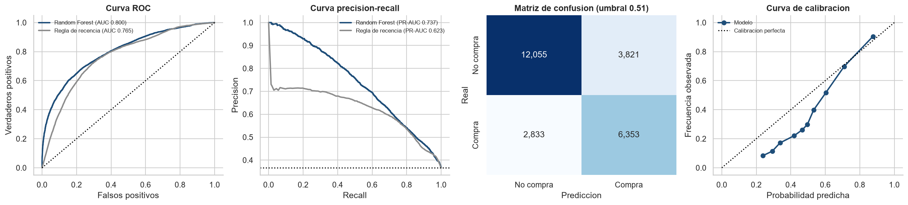
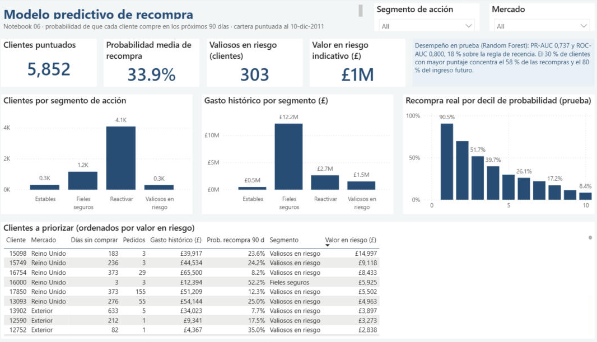

# Proyecto final · Análisis de datos y modelo predictivo para una aplicación de negocio

**Inteligencia de Negocios · Analítica de Datos · Aprendizaje Computacional · ITM 2026-2 · Grupo 3**
Caso: **retención de clientes en una tienda en línea mayorista** (Online Retail II)

| Integrante | Usuario de GitHub |
|---|---|
| Santiago Betancur | [@Xantyagoh](https://github.com/Xantyagoh) |
| Diego Alzate | [@DiegoA1123](https://github.com/DiegoA1123) |
| Carlos Mendez | [@carmarisx](https://github.com/carmarisx) |
| Sebastian Cadavid | [@Exmen9](https://github.com/Exmen9) |
| Daniel Martinez | [@danielmmnez](https://github.com/danielmmnez) |

Docentes: Carlos Jaramillo y Gustavo Macías (Inteligencia de Negocios) · Daniel Nieto (Analítica de Datos) · July Galeano (Aprendizaje Computacional)

---

## Qué entrega este proyecto

| Entregable del enunciado | Dónde está |
|---|---|
| Notebook de Python con código y explicaciones | [`notebooks/`](notebooks/) (01 a 06) y [`src/etl.py`](src/etl.py) |
| Documento formal con análisis y resultados | [`docs/Informe_Final.docx`](docs/Informe_Final.docx) |
| Dashboard con herramientas de BI | [`dashboard/grupo3_proyecto_final.pbix`](dashboard/grupo3_proyecto_final.pbix) (7 páginas, Power BI) y [`dashboard/capturas/`](dashboard/capturas/) |
| Presentación y sustentación | [`docs/Presentacion_Final.pptx`](docs/Presentacion_Final.pptx) |

## Problema y objetivo

La tienda vende £18,9 M en dos años, pero **depende de pocos clientes** (el 20 % genera el 77 % del ingreso), **es muy estacional** y **deja ir a la mitad de los clientes nuevos** (solo el 46,7 % recompra en 90 días). No es posible contactar a todos: hay que **priorizar**. El proyecto recorre las cinco fases del enunciado y cierra con un **modelo que predice qué clientes comprarán en los próximos 90 días** y una **matriz de acción** que cruza esa probabilidad con el valor del cliente.

## Dataset

**Online Retail II** (UCI Machine Learning Repository, id 502 · [DOI 10.24432/C5CG6D](https://doi.org/10.24432/C5CG6D) · CC BY 4.0): 1.067.371 líneas de factura de una tienda en línea del Reino Unido entre dic-2009 y dic-2011. Detalle en [`data/README.md`](data/README.md).

## Fases del proyecto

| Fase (enunciado) | Qué se hace | Dónde |
|---|---|---|
| 1. Recopilación y transformación (ETL) | Descarga, limpieza con 5 reglas trazables, 13 validaciones automáticas, modelo en estrella | `src/descargar_datos.py`, **`src/etl.py`**, notebook 02 |
| 2. Análisis exploratorio | Calidad, univariado y multivariado, RFM, cohortes, 6 hipótesis con tamaño del efecto | notebooks 01, 03, 04 |
| 3. Inteligencia de negocios | Reglas de negocio, modelo en estrella, 7 KPIs y dashboard de 7 páginas | notebook 05, `dashboard/` |
| 4. Modelado predictivo | Recompra a 90 días, validación temporal, ajuste, interpretación, equidad y valor de negocio | **notebook 06** |
| 5. Conclusiones y recomendaciones | Decisiones D1 a D7 con evidencia, riesgos éticos y limitaciones | `docs/Informe_Final.docx`, `docs/storytelling_y_decisiones.md` |

## Estructura del repositorio

```
├── README.md
├── requirements.txt
├── src/
│   ├── descargar_datos.py     descarga el dataset desde la UCI
│   └── etl.py                 ETL automatizado: crudo → limpio → estrella, con validaciones
├── notebooks/                 01 a 06
├── data/
│   ├── README.md              fuente, licencia y diccionario de datos
│   ├── raw/                   datos originales (no se versionan)
│   └── processed/
│       ├── lineas_limpias.parquet, modelo_bi/ (estrella), rfm_clientes.parquet
│       ├── reporte_etl.json   reglas aplicadas y resultado de las validaciones
│       └── modelo_predictivo/ puntaje de clientes, métricas y tablas del modelo
├── dashboard/                 .pbix, medidas DAX, tema, guía y capturas
└── docs/                      informe, presentación, figuras y storytelling
```

## Cómo reproducir

```bash
git clone https://github.com/Xantyagoh/grupo3-proyecto-final-ecommerce.git
cd grupo3-proyecto-final-ecommerce
python -m venv venv
venv\Scripts\activate            # Mac/Linux: source venv/bin/activate
pip install -r requirements.txt
python src/descargar_datos.py    # descarga y convierte los datos (1-2 min)
python src/etl.py                # ETL completo + 13 validaciones (≈ 10 s)
jupyter notebook                 # ejecutar los notebooks 01 a 06 en orden (Restart & Run All)
```

El notebook 06 tarda ~2 minutos y regenera `data/processed/modelo_predictivo/` y las figuras `docs/figuras/06_*.png`.
El dashboard se abre con **Power BI Desktop**; si pide actualizar datos, ajustar el parámetro `RutaDatos` a la carpeta `data/processed/` del repositorio clonado (ver `dashboard/medidas_dax.md`).

## Resultados principales

### Datos y ETL
- **1.067.371** líneas → **1.021.326** limpias (95,7 %): duplicados exactos (34.335), códigos que no son producto (5.723), precios ≤ 0 (5.983) y 4 líneas de dos pedidos gigantes cancelados a los minutos.
- El ETL automatizado reproduce **exactamente** las tablas de los notebooks y supera **13/13 validaciones** (llaves, rangos, signos, integridad referencial, cuadre de ingresos: £18.929.107,51).

### KPIs

| KPI | Valor |
|---|---|
| K1 Ingresos netos | **£18,93 M** |
| K2 Ticket promedio | **£491** · 39.514 pedidos |
| K3 Tasa de devolución | **2,4 %** |
| K4 Clientes activos | **5.852** |
| K5 Recompra a 90 días | **46,7 %** |
| K6 Concentración (20 % de clientes) | **77 %** del ingreso |
| K7 Crecimiento interanual | **+2,3 %** |

### Modelo predictivo (notebook 06)

Pregunta: *¿comprará este cliente en los próximos 90 días?* Clasificación binaria sobre 72.985 filas (cliente × corte mensual), con variables calculadas solo con datos anteriores al corte, **división temporal** (entrenamiento mar-2010 a feb-2011; prueba may a sep-2011) y **validación cruzada de ventana creciente**.

| Modelo | PR-AUC en validación cruzada |
|---|---|
| Regla de recencia (línea base) | 0,588 |
| Regresión logística | 0,725 |
| **Random Forest (elegido)** | **0,727** |
| Gradient Boosting | 0,727 |

**Prueba final (nunca vista):** PR-AUC **0,737** (IC 95 %: 0,722 a 0,750) y ROC-AUC **0,800**, **18 % más de PR-AUC** que la regla de recencia; precisión 0,624, recall 0,692, F1 0,656. El desempeño se sostiene en cada mes de prueba (PR-AUC de 0,722 a 0,756).

- **Qué predice:** hábito reciente de compra (`pedidos_180d`, `gasto_90d`, recencia), no atributos del cliente.
- **Ordena bien:** el 30 % de clientes con mayor puntaje concentra el **58 %** de las recompras y el **80 %** del ingreso futuro.
- **Equidad:** rinde igual en Reino Unido y Exterior; es débil con clientes de **un solo pedido** (recall 5 %).
- **Aviso de calibración:** las probabilidades son optimistas (+13 puntos) cuando la temporada es floja; sirve sobre todo como **ranking** y debe recalibrarse.



**Matriz de acción** (5.852 clientes puntuados al 10-dic-2011):

| Segmento | Clientes | % del gasto histórico | Acción |
|---|---|---|---|
| Fieles seguros | 1.160 | 72 % | Mantener; sin descuentos |
| Estables | 313 | 3 % | Comunicación de bajo costo |
| **Valiosos en riesgo** | **303** | **9 %** | **Retención personalizada (prioridad)** |
| Reactivar | 4.076 | 16 % | Campaña masiva de bajo costo |

### Hallazgos del análisis exploratorio
- **Estacionalidad fuerte:** septiembre-noviembre = 1,2 / 1,4 / 1,8 veces el mes promedio (H1: efecto grande, r = 0,76).
- **Concentración 80/20:** el 20 % de clientes aporta 77 % del ingreso; el 20 % de productos, 78 %; el Reino Unido, 85 %.
- **Segmentos RFM (k = 4):** *Campeones* (20 % de clientes, 74 % del ingreso), *En riesgo*, *Recientes* y *Dormidos*.
- **Hipótesis:** 5 de 6 se rechazan; H6 (recompra por mercado) no se rechaza. Las decisiones se basan en el tamaño del efecto.

## Dashboard

Power BI de **7 páginas**: resumen ejecutivo, ventas y estacionalidad, clientes y retención, mercados y devoluciones, productos, hipótesis y decisiones, y **modelo predictivo** (probabilidad de recompra, matriz de acción y lista de clientes a priorizar). Segmentadores sincronizados, filtrado cruzado y tooltips. Capturas en [`dashboard/capturas/`](dashboard/capturas/) y medidas en [`dashboard/medidas_dax.md`](dashboard/medidas_dax.md).



## Conclusiones y recomendaciones

1. **El negocio es estacional y concentrado:** adelantar inventario y marketing a agosto-septiembre (D1) y proteger a los *Campeones* (D3).
2. **La retención es el cuello de botella:** solo 46,7 % recompra en 90 días; los captados en temporada alta recompran 7,6 puntos menos (D2: campaña de retención en diciembre-enero).
3. **Es posible anticipar la recompra con utilidad práctica** (PR-AUC 0,737, +18 % sobre la regla de recencia) usando solo hábito reciente de compra.
4. **La acción de mayor valor cruza probabilidad y valor (D7):** retención personalizada para los **303 clientes valiosos en riesgo** y sin descuentos para los **1.160 fieles seguros**.
5. **Hay que medir antes de escalar:** el modelo dice quién tiene más probabilidad de comprar, no quién responderá a una campaña; se necesita un **experimento con grupo de control**.

Detalle de la narrativa, decisiones D1 a D7 y limitaciones en [`docs/storytelling_y_decisiones.md`](docs/storytelling_y_decisiones.md) y en el informe.

## Ética y limitaciones (resumen)

- El `Customer ID` es anónimo, pero un historial de compras vinculado a una persona o empresa sería dato personal (RGPD/UK GDPR): en un uso real hace falta base legal y minimización de datos.
- El modelo **prioriza esfuerzos comerciales; no debe usarse para negar servicio, precio o crédito.**
- Solo 2 años y un comercio (un único ciclo estacional en entrenamiento); el 22 % de las líneas no tiene cliente; no hay costos ni márgenes; los análisis son observacionales (asociación, no causalidad).

## Referencias

- Chen, D. (2019). *Online Retail II* [Dataset]. UCI Machine Learning Repository. https://doi.org/10.24432/C5CG6D
- Chen, D., Sain, S. L., & Guo, K. (2012). Data mining for the online retail industry: A case study of RFM model-based customer segmentation using data mining. *Journal of Database Marketing & Customer Strategy Management, 19*(3), 197-208.
- Fader, P. S., Hardie, B. G. S., & Lee, K. L. (2005). "Counting your customers" the easy way. *Marketing Science, 24*(2), 275-284.
- Breiman, L. (2001). Random forests. *Machine Learning, 45*(1), 5-32.
- Saito, T., & Rehmsmeier, M. (2015). The precision-recall plot is more informative than the ROC plot when evaluating binary classifiers on imbalanced datasets. *PLoS ONE, 10*(3), e0118432.
- Pedregosa, F., et al. (2011). Scikit-learn: Machine learning in Python. *JMLR, 12*, 2825-2830.
